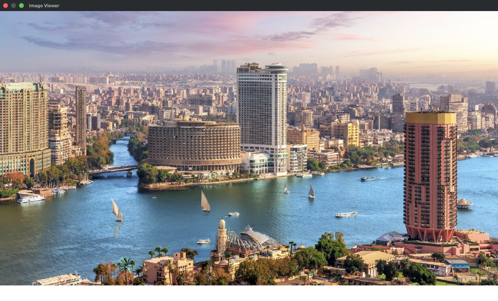
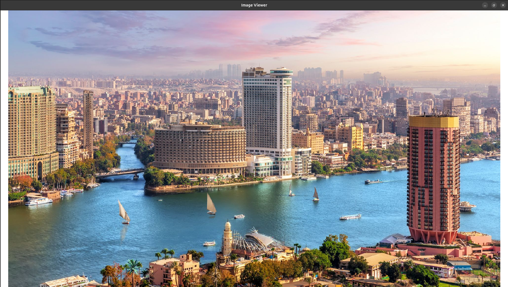
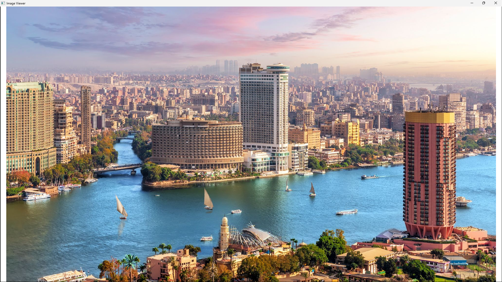

# Image Viewer

A cross-platform image viewer for macOS, Linux, and Windows. Just a learning project

## Build & Run

```bash
make release
make debug
./prog <image-name>
```
<h2>macOS</h2>



<h2>Ubuntu Linux</h2>



<h2>Windows</h2>


